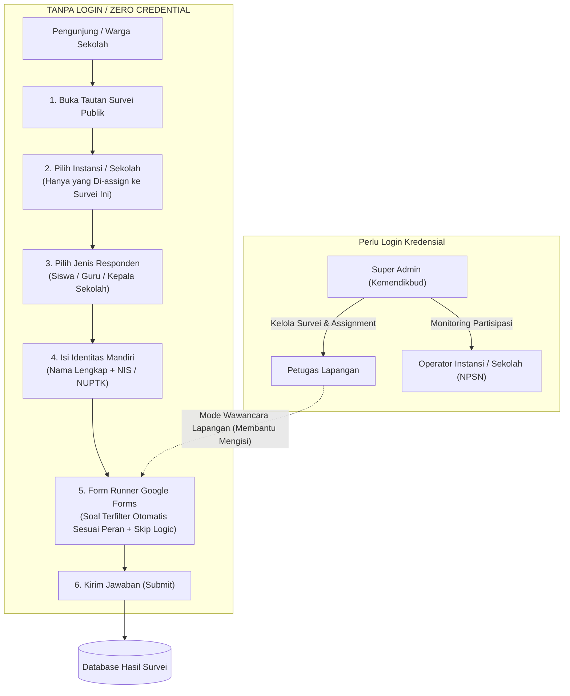

# Product Requirements Document (PRD) & Technical Blueprint
## Transformasi Sistem Survei Menuju Standar Operasional & UI Ala Google Forms

---

## 1. Executive Summary & Audit Kesenjangan (Gap Analysis)

Dokumen ini merupakan panduan arsitektur dan spesifikasi kebutuhan produk (PRD) untuk memodernisasi aplikasi survei yang sudah ada (`pro-backend-survei` berbasis **NestJS 11 + Prisma 6 + MySQL** dan `pro-frontend-survei` berbasis **Next.js 15 App Router + Tailwind CSS 4 + TypeScript**). 

Tujuan transformasi ini adalah mengubah sistem survei yang saat ini kaku (berbasis modal popup, urutan statis, tipe input terbatas, dan data responden terisolasi) menjadi platform **Form Builder & Form Runner dinamis berstandar Google Forms** dengan hierarki pengguna pendidikan (Admin, Petugas Lapangan Multi-Instansi, Instansi/Sekolah dengan NPSN, serta sub-responden Siswa/NIS, Guru/NUPTK, dan Kepala Sekolah/NUPTK).

### Matriks Kesenjangan (Current State vs. Target State)

| Aspek | Kondisi Saat Ini (Current State) | Target Transformasi (Google Forms-like) |
| :--- | :--- | :--- |
| **Penyusunan Survei (Builder)** | Form modal kaku per pertanyaan (`addInstrumen.tsx`), tanpa visual canvas terintegrasi. | **Interactive Form Builder Canvas** ala Google Forms dengan floating toolbar, auto-save, kartu pertanyaan dinamis, dan navigasi bagian. |
| **Urutan Pertanyaan & Halaman** | Urutan pertanyaan dan kategori mengikuti ID `autoincrement` di basis data. Tidak bisa dipindah. | **Drag-and-Drop Reordering** penuh baik untuk urutan pertanyaan maupun urutan halaman (Page/Kategori). Dilengkapi field `order_index`. |
| **Relasi & Percabangan Pertanyaan** | Statis; hanya ada pemisah grup responden dasar (`for_responden_group`). Pertanyaan berikutnya tidak peka terhadap jawaban sebelumnya. | **Dynamic Conditional Logic (Skip Logic & Branching)**: Pertanyaan turunan muncul otomatis berdasarkan jawaban opsi tertentu, atau loncat ke halaman (page) tertentu. |
| **Tipe Input Pertanyaan** | Terbatas pada `PILIHAN` (radio), `ISIAN` (text), dan `CHECKBOX`. | Lengkap seperti Google Forms: **Pilihan Ganda**, **Kotak Centang**, **Jawaban Singkat**, **Paragraf**, **Dropdown**, **Upload File Dokumen/Gambar**, **Skala Linear (1-5/1-10)**, dan **Tanggal/Waktu**. |
| **Akses Pengisian Publik (Zero-Credential)** | Pengisian mengharuskan akun/kredensial login untuk instansi, menyulitkan partisipasi warga sekolah luas. | **Zero-Credential Public Access**: Warga sekolah (Siswa, Guru, Kepsek) **tidak perlu login**. Cukup: **Pilih Survei $\rightarrow$ Pilih Sekolah (yang di-assign) $\rightarrow$ Pilih Jenis Responden $\rightarrow$ Validasi NIS/NUPTK $\rightarrow$ Isi Form**. |
| **Struktur Responden & Role** | Role sistem: `ADMIN`, `PETUGAS`, `SEKOLAH`, `DINAS`. Identitas sub-responden sekolah (Siswa, Guru, Kepsek) belum memiliki skema terstruktur. | **Hierarki Responden Berjenjang**: Instansi memiliki **NPSN**. Responden dibagi menjadi **Siswa (NIS)**, **Guru (NUPTK)**, dan **Kepala Sekolah (NUPTK)**. Admin dapat memfilter dan mengaudit data user berdasarkan rolenya. |
| **Penugasan Petugas** | Model `assignments` ada, namun UI manajemen multi-instansi dan alur wawancara lapangan belum optimal. | **Multi-Instansi Assignment Portal**: Petugas dapat di-assign ke banyak sekolah per survei, memiliki mode wawancara khusus dengan pemilihan identitas responden di lapangan. |
| **Tampilan Pengisian (Runner)** | Layout tabel datar dengan tab horizontal sederhana, input formulir konvensional. | **Google Forms Look & Feel**: Header banner card, shadow card putih terfokus, progress bar per halaman, transisi halus, indikator "Wajib diisi (*)". |

---

## 2. Struktur Akses Pengguna & Model Partisipasi (Access & Governance)

Sistem membedakan secara tegas antara **Pengguna Terautentikasi (Manajemen/Petugas)** dan **Responden Kuesioner Publik (Zero-Credential Public Flow)**:



---

### 2.1. Alur Pengisian Kuesioner Publik (Zero-Credential Public Flow)

Untuk memaksimalkan partisipasi dan mempermudah pengisian oleh ribuan siswa dan guru tanpa hambatan registrasi/login, kuesioner publik menerapkan alur **5 Langkah Cepat**:

1. **Langkah 1: Akses Survei**:
   - Responden membuka URL publik survei (misal: `/form/evaluasi-vokasi-2026` atau via QR Code yang dibagikan).
   - Sistem menampilkan judul survei, deskripsi pengantar, dan banner identitas Kemendikbud.
2. **Langkah 2: Pemilihan Instansi / Sekolah (Target Assignment)**:
   - Responden memilih nama sekolah/instansi asalnya.
   - **Ketentuan Krusial**: Daftar pilihan sekolah pada dropdown/search selector **HANYA menampilkan sekolah-sekolah yang telah di-assign ke survei tersebut** oleh Admin (berdasarkan relasi `assignments`).
   - Dilengkapi kolom pencarian cepat (*search-as-you-type*) menggunakan Nama Sekolah atau NPSN.
3. **Langkah 3: Pemilihan Jenis Responden**:
   - Responden memilih salah satu peran:
     - 👦 **Siswa**: Otomatis membuka input **NIS / NISN**.
     - 👩‍🏫 **Guru**: Otomatis membuka input **NUPTK / NIP**.
     - 🏛️ **Kepala Sekolah**: Otomatis membuka input **NUPTK / NIP**.
4. **Langkah 4: Entri Identitas Singkat**:
   - Mengisi Nama Lengkap responden dan Nomor Identitas resmi (NIS/NUPTK).
   - Data ini otomatis disimpan/dihubungkan ke entitas `responden_sekolah` di database.
5. **Langkah 5: Pengisian Form & Evaluasi Percabangan**:
   - Sistem secara otomatis memuat butir pertanyaan yang relevan dengan jenis responden terpilih.
   - Paginasi kuesioner per halaman ala Google Forms dengan *progress bar* keterisian.
   - Pertanyaan bersyarat (*skip logic*) aktif secara dinamis.
   - Responden menekan tombol **Kirim Formulir (Submit)**.

---

### 2.2. Spesifikasi Pengguna Terautentikasi (Login Berbasis Akun)

1. **Super Admin / Admin Pusat**:
   - Login menggunakan username dan password terenkripsi.
   - Membuat dan mengelola Preset Survei, Halaman/Bagian, Butir Pertanyaan, Tipe Input, dan Relasi Logika.
   - Melakukan penugasan survei ke instansi (*Survey Assignment*), baik untuk pengisian mandiri publik maupun penugasan petugas lapangan.
   - Memantau dasbor analitik dan audit data responden berjenjang (filter berdasarkan Role, NPSN, Siswa/NIS, Guru/NUPTK, Kepsek/NUPTK).
2. **Petugas (Interviewer Lapangan)**:
   - Login menggunakan akun petugas.
   - Memiliki daftar penugasan sekolah binaan (*Multi-Instansi per Survei*).
   - Menggunakan **Mode Wawancara Khusus**: Petugas memilih sekolah binaan $\rightarrow$ mewawancarai responden (Siswa/Guru/Kepsek) $\rightarrow$ menyertakan tanda tangan digital (Canvas Signature) dan pencatatan titik lokasi GPS otomatis.
3. **Operator Instansi / Sekolah (NPSN)**:
   - Login menggunakan NPSN sebagai kredensial resmi.
   - Berfungsi sebagai **Monitoring Portal**: Memantau statistik partisipasi warga sekolah (Berapa siswa yang sudah mengisi? Apakah guru dan kepala sekolah sudah menuntaskan kuesioner?).

---

## 3. Spesifikasi Fungsional Preset Survei Ala Google Forms

### 3.1. Konsep Section / Page (Halaman Bertahap)
Survei dibagi menjadi **Halaman (Bagian/Section)**:
- Setiap bagian memiliki judul bagian, deskripsi pengantar, dan daftar pertanyaan.
- Urutan bagian dapat di-reorder (drag-and-drop halaman).
- Halaman dapat memiliki pengaturan navigasi: *Lanjut ke bagian berikutnya*, *Lanjut ke bagian spesifik (berdasarkan jawaban)*, atau *Kirim formulir*.

### 3.2. Ragam Tipe Input Pertanyaan (Rich Input Types)
1. **PILIHAN_GANDA** (*Multiple Choice / Radio*): Satu opsi dari banyak pilihan. Dilengkapi fitur *"Tambahkan Opsi 'Lainnya'"*.
2. **KOTAK_CENTANG** (*Checkboxes*): Memilih satu atau lebih opsi jawaban. Dilengkapi fitur catatan tambahan per opsi.
3. **DROPDOWN**: Pemilihan satu opsi menggunakan menu tarik-turun (cocok untuk opsi panjang).
4. **ISIAN_SINGKAT** (*Short Answer*): Teks 1 baris (nama, nomor identitas, alamat singkat).
5. **PARAGRAF** (*Paragraph*): Teks multi-baris untuk uraian atau jawaban panjang.
6. **UPLOAD_FILE** (*File Upload*): Upload bukti dukung (PDF, JPG, PNG, DOCX) dengan batas ukuran file (e.g. max 5MB / 10MB) dan kuota file.
7. **SKALA_LINEAR** (*Linear Scale / Rating*): Skala nilai (misal 1 s/d 5) dengan label batas bawah (*Sangat Kurang*) dan batas atas (*Sangat Baik*).
8. **TANGGAL & WAKTU** (*Date / Time Picker*): Input tanggal terstandardisasi (ISO format).

### 3.3. Urutan Fleksibel & Drag-and-Drop (Reordering System)
- **UI Drag Handle**: Terdapat pegangan 6 titik (`⋮⋮`) di bagian atas-tengah setiap kartu pertanyaan dan kartu bagian.
- **Interaksi Drag-and-Drop**: Pengguna dapat menarik kartu pertanyaan ke atas/bawah di dalam bagian yang sama, atau memindahkannya ke bagian lain.
- **Sinkronisasi Otomatis**: Backend menyediakan endpoint batch reorder:
  ```json
  PATCH /api/instruments/reorder
  {
    "id_survey": "uuid-survey",
    "items": [
      { "uuid": "pertanyaan-uuid-1", "order_index": 1, "id_kategori": "kategori-uuid-1" },
      { "uuid": "pertanyaan-uuid-2", "order_index": 2, "id_kategori": "kategori-uuid-1" }
    ]
  }
  ```

### 3.4. Relasi Logika Bersyarat (Conditional & Skip Logic Engine)
Pertanyaan dapat memiliki aturan keterkaitan terhadap jawaban pertanyaan sebelumnya:
- **Rule Structure**:
  ```json
  {
    "depends_on_question_uuid": "pertanyaan-uuid-a",
    "operator": "EQUALS", // EQUALS | NOT_EQUALS | IN | IS_CHECKED
    "expected_value": "opsi-uuid-atau-teks",
    "action": "SHOW" // SHOW | HIDE
  }
  ```
- **Contoh Kasus Penggunaan**:
  - *Pertanyaan 1*: "Apakah sekolah memiliki laboratorium komputer?" (Pilihan: Ya / Tidak).
  - *Pertanyaan 2 (Bersyarat)*: "Berapa unit komputer yang aktif?" -> **Hanya tampil jika Pertanyaan 1 dijawab "Ya"**.
  - *Opsi Navigasi Bagian*: Memilih "Lanjut ke Bagian 3: Lab Komputer" jika Ya, atau "Lanjut ke Bagian 4: Olahraga" jika Tidak.

---

## 4. Desain Antarmuka Pengguna (UI/UX Design Specification)

### 4.1. Form Builder Canvas (Admin View)
- Kartu judul dengan aksen garis ungu/biru di atas.
- Kartu pertanyaan terfokus dengan penanda garis tepi aktif di sisi kiri.
- Toolbar mengambang (*floating toolbar*) di sebelah kanan kanvas untuk:
  - Tambah Pertanyaan (`+`)
  - Tambah Judul/Deskripsi (`Tt`)
  - Tambah Bagian Baru / Page Break (`〓`)
  - Impor Pertanyaan dari Template (`⎘`)

### 4.2. Form Runner Canvas (Tampilan Kuesioner Publik & Petugas)
- **Header Banner**: Menampilkan logo resmi Kemendikbud, warna aksen identitas aplikasi, judul kuesioner, dan petunjuk umum.
- **Kartu Identitas Responden (Bagian Awal)**:
  - Dropdown Pencarian Sekolah Binaan yang Di-assign.
  - Radio Card Pilihan Jenis Responden (Siswa / Guru / Kepala Sekolah).
  - Kolom Nama Lengkap dan NIS / NUPTK dengan validasi Zod instan.
- **Progress Bar**: Menampilkan persentase keterisian dan penanda `Halaman 1 dari 3` disertai pesan motivasi ceria (*encouraging progress*).
- **Active Card Elevation**: Setiap input berada dalam kartu berwarna putih dengan bayangan lembut (`shadow-sm hover:shadow-md`) dengan border radius modern (`rounded-2xl`).
- **Dynamic Conditional Rendering**: Begitu responden memilih salah satu opsi, pertanyaan berikutnya yang berkaitan langsung muncul dengan transisi animasi halus (*fade-in slide-down*) tanpa refresh halaman.
- **Bottom Navigation**: Tombol `Kembali`, `Berikutnya`, dan `Kirim Formulir`.
