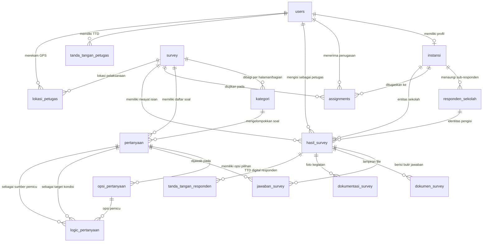

# Database Schema Specification (SCHEMA.md)
## Representasi Skema Basis Data & Relasi Platform Survei Kemendikbud

---

## 1. Entity Relationship Diagram (ERD)

---

## 2. Definisi Tipe Enum

- **`Role`**: `ADMIN`, `PETUGAS`, `INSTANSI`, `DINAS`
- **`SubRoleResponden`**: `SISWA`, `GURU`, `KEPALA_SEKOLAH`, `UMUM`
- **`JenisPertanyaan`**: `PILIHAN_GANDA`, `KOTAK_CENTANG`, `DROPDOWN`, `ISIAN_SINGKAT`, `PARAGRAF`, `UPLOAD_FILE`, `SKALA_LINEAR`, `TANGGAL`
- **`LogicOperator`**: `EQUALS`, `NOT_EQUALS`, `IN`, `IS_EMPTY`, `IS_NOT_EMPTY`
- **`TipeInstansi`**: `SEKOLAH`, `DINAS`

---

## 3. Kamus Entitas Kunci

1. **`users`**: Akun autentikasi login (Admin, Petugas, Instansi) dengan hashing bcrypt.
2. **`instansi`**: Entitas sekolah dengan identitas **`kode_instansi`** / **`npsn`** (Nomor Pokok Sekolah Nasional) yang diindeks secara unik.
3. **`responden_sekolah`**: Sub-responden warga sekolah: **Siswa (NIS/NISN)**, **Guru (NUPTK)**, dan **Kepala Sekolah (NUPTK)**.
4. **`survey`**: Master preset survei kuesioner.
5. **`kategori`**: Halaman / Bagian (*Section / Page*) kuesioner dilengkapi kolom **`order_index`** untuk drag-and-drop.
6. **`pertanyaan`**: Butir pertanyaan kuesioner dengan kolom **`order_index`**, tipe input lengkap, `for_sub_role`, `file_config`, dan `scale_config`.
7. **`opsi_pertanyaan`**: Opsi pilihan jawaban dengan fitur catatan ("Lainnya...") dan **`goto_kategori_uuid`** untuk lompat bagian (*page branching*).
8. **`logic_pertanyaan`**: Tabel aturan logika percabangan (*conditional visibility*) antar butir pertanyaan.
9. **`assignments`**: Penugasan petugas wawancara ke multi-instansi per survei (`@@unique([id_survey, id_petugas, id_instansi])`).
10. **`hasil_survey` & `jawaban_survey`**: Rekaman hasil pengisian kuesioner oleh responden atau wawancara petugas.

---

## 4. Multi-Provider Database Support

Skema basis data dirancang kompatibel lintas sistem manajemen basis data relasional:
- **MySQL / MariaDB** (Default)
- **PostgreSQL**
- **SQLite**
- **Microsoft SQL Server**

Untuk panduan konfigurasi dan cara berpindah provider secara dinamis, lihat dokumen [DATABASE_MULTI_PROVIDER.md](file:///e:/Project/app-survei/docs/DATABASE_MULTI_PROVIDER.md).

---

## 5. Skema Prisma Siap Pakai

Skema lengkap dapat ditemukan langsung pada model Prisma di backend `prisma/schema.prisma` (dan master template `prisma/schema.template.prisma`) yang telah disinkronkan dengan ERD di atas.

