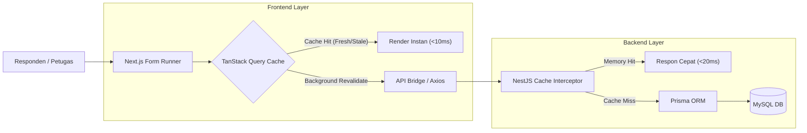

# Technical Requirements Document (TRD)
## Arsitektur Teknis, Optimasi Performa, Caching TanStack, Validasi Zod, dan Rekstrukturisasi Proyek

---

## 1. Sasaran Teknis & Prinsip Arsitektur (Technical Objectives)

Dokumen ini mendefinisikan spesifikasi teknis implementasi untuk memodernisasi repositori `pro-backend-survei` dan `pro-frontend-survei`. Sasaran arsitektural yang ingin dicapai meliputi:

1. **Zero-Latency Drag & Drop UX**: Reordering pertanyaan dan halaman berlangsung instan di sisi antarmuka menggunakan **Optimistic Updates** melalui **TanStack Query v5**.
2. **End-to-End Type Safety & Data Validation**: Mengintegrasikan **Zod** dan **React Hook Form** untuk mencegah data anomali (validasi format NPSN, NIS, NUPTK, validasi batas file upload, dan konsistensi relasi percabangan).
3. **Multi-Layer Caching Strategy**: Reduksi beban database hingga 80% dengan client-side caching untuk struktur survei yang sering dibaca namun jarang berubah, dipadukan dengan in-memory/Redis caching pada backend NestJS.
4. **Offline & Low-Bandwidth Resilience**: Petugas lapangan yang melakukan survei di daerah minim sinyal dapat menyimpan isian sementara ke dalam *local draft cache* tanpa kehilangan progres.
5. **Clean Architecture & Scalable Project Structure**: Menghapus redundansi kode (seperti duplikasi route `kuesioner`/`kuisioner`), membersihkan struktur folder bersarang (*double-nested*), dan menerapkan struktur modular berbasis domain (*feature-based*).

---

## 2. Pembaruan Dependensi & Ekosistem Library

### 2.1. Frontend (`pro-frontend-survei`)

| Library / Paket | Versi Rekomendasi | Peran & Tujuan |
| :--- | :--- | :--- |
| `@tanstack/react-query` | `^5.66.0` | Client-side caching, deduplikasi request, stale-while-revalidate, dan optimistic updates untuk drag & drop. |
| `@tanstack/react-query-devtools` | `^5.66.0` | Debugging status cache, fetching, dan reaktivitas query. |
| `zod` | `^3.24.2` | Deklarasi skema validasi deklaratif dan inferensi tipe TypeScript statis secara terpusat. |
| `react-hook-form` | `^7.54.2` | Form state management tanpa re-render berlebihan (uncontrolled components) untuk performa formulir kuesioner berskala besar. |
| `@hookform/resolvers` | `^3.10.0` | Jembatan integrasi antara Zod schema dengan React Hook Form. |
| `@dnd-kit/core` | `^6.3.1` | Engine drag-and-drop modern, ringan, dan kompatibel penuh dengan React 19 / Next.js 15 App Router. |
| `@dnd-kit/sortable` | `^10.0.0` | Preset khusus untuk reordering kartu pertanyaan dan tab halaman/kategori. |
| `@dnd-kit/utilities` | `^3.2.2` | Helper CSS transform dan kalkulasi posisi pointer. |
| `lucide-react` | `^0.475.0` | Ikonografi modern, konsisten, dan ringan ala Google Workspace (menggantikan ikon SVG inline yang tidak seragam). |
| `clsx` & `tailwind-merge` | `^2.1.1` & `^3.0.1` | Pengelolaan utility class dinamis tanpa benturan spesifisitas (*class clash*). |

---

### 2.2. Backend (`pro-backend-survei`)

| Library / Paket | Versi Rekomendasi | Peran & Tujuan |
| :--- | :--- | :--- |
| `@nestjs/cache-manager` | `^3.0.0` | Abstraksi caching bawaan NestJS untuk menyimpan representasi kuesioner publik. |
| `cache-manager` | `^6.4.0` | Cache engine backend (dukungan memory store dan Redis store). |
| `@nestjs/throttler` | `^6.4.0` | Rate limiting per-IP/User untuk melindungi endpoint `/submission` dari spam/bot. |
| `helmet` | `^8.0.0` | Pengamanan header HTTP standar industri. |
| `compression` | `^1.7.5` | Kompresi gzip/brotli untuk memangkas ukuran payload JSON survei besar hingga 70%. |
| `class-validator` & `class-transformer` | Tetap / Update | Validasi DTO di lapisan pipa (ValidationPipe) NestJS. |

---

## 3. Strategi Caching & Optimasi Performa



### 3.1. Frontend Caching (TanStack Query v5)

```typescript
// lib/query-client.ts
import { QueryClient } from '@tanstack/react-query';

export function makeQueryClient() {
  return new QueryClient({
    defaultOptions: {
      queries: {
        staleTime: 1000 * 60 * 5, // Data kuesioner segar selama 5 menit
        gcTime: 1000 * 60 * 30,    // Cache disimpan selama 30 menit
        refetchOnWindowFocus: false,
        retry: 1,
      },
    },
  });
}
```

```typescript
// lib/query-keys.ts
export const surveyKeys = {
  all: ['surveys'] as const,
  lists: () => [...surveyKeys.all, 'list'] as const,
  list: (filters: object) => [...surveyKeys.lists(), { filters }] as const,
  details: () => [...surveyKeys.all, 'detail'] as const,
  detail: (id: string) => [...surveyKeys.details(), id] as const,
  instruments: (surveyId: string) => [...surveyKeys.detail(surveyId), 'instruments'] as const,
  assignedInstitutions: (publicLink: string) => [...surveyKeys.all, 'assigned-institutions', publicLink] as const,
};

export const userKeys = {
  all: ['users'] as const,
  hierarchy: (params: object) => [...userKeys.all, 'hierarchy', params] as const,
};
```

---

## 4. Blueprint Rekstrukturisasi Proyek (Directory Restructuring)

### 4.1. Solusi Masalah Double-Nested Directory
Meratakan (*flatten*) folder langsung ke tingkat:
```
e:\Project\app-survei\
  ├── docs/       <-- Dokumentasi Arsitektur (PRD, TRD, DESIGN, SCHEMA, API)
  ├── AGENT.md    <-- Gerbang Panduan Agent & Developer
  ├── backend/    <-- Pro-backend NestJS
  └── frontend/   <-- Pro-frontend Next.js
```

### 4.2. Standar Struktur Frontend (Next.js 15 App Router - Feature Based)
```
frontend/src/
├── app/
│   ├── (auth)/login/page.tsx
│   ├── (dashboard)/admin/surveys/[id]/builder/page.tsx
│   ├── (dashboard)/petugas/interview/page.tsx
│   ├── (dashboard)/instansi/survey/page.tsx
│   ├── form/[publicId]/page.tsx
│   └── providers.tsx
├── features/
│   ├── survey-builder/ (Canvas, QuestionCard, FloatingToolbar, LogicModal)
│   ├── survey-runner/ (FormHeader, PageSection, ProgressBar)
│   └── user-management/ (UserTable, HierarchyFilter)
├── components/ui/ (button, input, modal, badge, dropdown)
├── lib/ (api-client, query-client, query-keys, utils)
└── schemas/ (survey.schema, submission.schema, user.schema)
```

